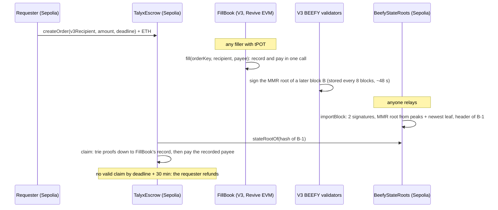

# Talyx

An escrow on Sepolia pays a filler only after a Portaldot V3 BEEFY proof shows the exact tPOT reached the exact V3
recipient, giving EVM users a committee-free way onto V3.


**Testnet only. Unaudited.** Built for the Portaldot Hacker House 2026, Multi-Chain & Cross-Chain Infra track.

## Who you trust

| Route onto V3 | Who can steal or block | Proof checked on chain |
| --- | --- | --- |
| Official bridge (POT ↔ BSC) | the operator (custody model not stated) | none shown |
| BridgeZero, way back to V3 | a 2-of-3 committee; on the testnet one operator holds all three keys | none on V3 |
| PASTX | a single relayer | none |
| **Talyx** | nobody beyond V3's own validators; a filler risks only their own tPOT | BEEFY signatures, MMR root, header and storage proofs, on Sepolia |

What Talyx still trusts: **V3's 2 BEEFY keys (probably development keys) and V3's sudo key.** It trusts no relayer:
anyone can submit imports and claims, and a claim pays only the payee FillBook recorded on V3.

## How it works



1. The requester locks ETH in `TalyxEscrow` for X tPOT delivered to an address on V3.
2. Any filler pays that tPOT through `FillBook` on V3, which writes `payee | timestamp` under
   `keccak256(orderKey, recipient, amount)` in the same call that pays.
3. V3's two BEEFY validators sign the MMR root of a later block.
4. `BeefyStateRoots` on Sepolia checks both signatures, rebuilds the MMR root from the on-chain peaks plus the newest
   leaf, checks the header, and stores the state root.
5. `claim` proves FillBook's storage root and then the fill record under that state root, and pays the recorded
   payee. A forged proof reverts with a named error.

Proofs only flow out of V3. That is enough to protect users on the way in, so V3 needs no light client of any EVM
chain and no committee holds funds.

## Deployed

| Contract | Chain | Address |
| --- | --- | --- |
| `FillBook` | Portaldot V3 testnet (chain 420420777), block 293,226 | `0xbe86343e5c69f305b61680e142ada94fb4394068` |
| `BeefyStateRoots` | Sepolia | [`0xbe86343e5c69f305b61680e142ada94fb4394068`](https://sepolia.etherscan.io/address/0xbe86343e5c69f305b61680e142ada94fb4394068) |
| `TalyxEscrow` | Sepolia | [`0x908d8899795072985e35cb86da3aff88ce4e72e9`](https://sepolia.etherscan.io/address/0x908d8899795072985e35cb86da3aff88ce4e72e9) |

FillBook and BeefyStateRoots share an address because each was the deployer's first contract on its chain.
Deploy transactions, trie id and code hash: [deployments/testnet.json](deployments/testnet.json).

## Evidence

The first full order (all on 2 November 2026):

| Step | Chain | Transaction |
| --- | --- | --- |
| createOrder, 0.5 tPOT for 0.0001 ETH | Sepolia | [`0x15b0eeff…f72db7`](https://sepolia.etherscan.io/tx/0x15b0eeffc39075c9df2293d44aa5bf1b5763f278cd2e25e214af0129b0f72db7) |
| fill | V3 block 293,346 | `0xd549b9ef2d1fe8874f36553f0f651bbee9830cbd463fdbf929823f09deb00351` |
| importBlock, state root of 293,346 | Sepolia | [`0x0ebcdc9f…42bcb`](https://sepolia.etherscan.io/tx/0x0ebcdc9f1e94f44ae444b41d609f5e11d3c6785ed01a5342af14829fbfed1bcb) |
| claim, 0.0001 ETH to the recorded payee | Sepolia | [`0x9f93af02…755e0c`](https://sepolia.etherscan.io/tx/0x9f93af028ed8e6ac8d87861816cabc7a83173c61f709266ee5adfbf172755e0c) |

Forged claims sent as `eth_call` to the deployed escrow, each the real proof with one thing changed:

| Change | Reverts with |
| --- | --- |
| another payee | `WordMismatch` |
| fill time minus one second | `WordMismatch` |
| the proof used for another order (another recipient and amount) | `SlotMismatch` |
| a block hash Sepolia never imported | `UnknownBlock` |

A refund after the deadline plus the 30-minute claim window:
[`0xaeaeb111…1022ae`](https://sepolia.etherscan.io/tx/0xaeaeb111dff311ee524061eb09ea5c82c5791834eb0aeb34f0986b687e1022ae).
Every order, fill, import and claim so far: [docs/EVIDENCE.md](docs/EVIDENCE.md).

## Gas, measured on Sepolia

| Call | Gas | Source |
| --- | --- | --- |
| `importBlock` (2 signatures, 10 peaks, 230-byte header) | 292,436 to 406,522 | import transactions above and in docs/EVIDENCE.md |
| `claim` (main-trie and child-trie proofs) | 488,319 and 489,845 | claim transactions of orders 1 and 3 |
| `refund` | 45,091 | refund of order 2 |

For comparison, BridgeZero reports about 1.87M gas per GRANDPA header import on Sepolia (its README).

## Verify it yourself

You need Node 22+ and, for the contracts, [Foundry](https://getfoundry.sh).

```sh
git clone --recurse-submodules https://github.com/Dotman-Bei/Talyx.git && cd Talyx

# check the newest signed V3 block end to end against the public RPC:
# both BEEFY signatures, the MMR root, the header, the state root, a contract's storage
cd prover && npm install && npm run talyx -- spike

# every test: 50 prover tests and 50 Solidity tests, on proofs captured from live V3
npm test && cd ../contracts && forge test
```

To check the first claim by hand:

1. Open the claim transaction on Etherscan and read the block hash it proved against (`Claimed` event).
2. `npm run talyx -- verify-import <B>` rebuilds and checks the import of that signed block: it recovers both signers
   from `keccak256(commitment)` and compares them with `Beefy.Authorities`.
3. `npm run talyx -- forge-claim <orderId> --tamper payee` (or `time`, `block`, `order:<id>`) resends the claim with
   one thing changed, as `eth_call`. It reverts.

The [Verify page](web/verify/index.html) runs three of these checks in the browser on real V3 data.

## Run the demo

```sh
cd web && cp .env.example .env && npm install && npm run dev
```

Open `http://localhost:5173/app/`. The app reads orders from Sepolia and fills from V3, and sends every action through
MetaMask: post an order (Sepolia), fill it (V3; MetaMask is asked to add the network), import and claim (Sepolia; the
app builds the proof in the browser), refund. "Try a forged proof" sends tampered claims as `eth_call`. Leave the
three contract addresses in `.env` empty for a preview with sample orders.

## Run an order from the command line

```sh
cd prover && cp .env.example .env   # add a funded testnet key: Sepolia ETH and tPOT on V3
npm run talyx -- create-order <v3Recipient> 0.5 0.0001 --minutes 60
npm run talyx -- fill <orderId>         # pays on V3 through FillBook
npm run talyx -- check-slot <orderId>   # the fill record where the escrow expects it
npm run talyx -- claim <orderId>        # imports the newest signed block if needed, then claims
npm run talyx -- refund <orderId>       # after the deadline plus the claim window
```

`npm run talyx -- help` lists every command, including `deploy-fillbook` and `deploy-sepolia`.

## Repository

| Path | What it is |
| --- | --- |
| `contracts/` | `BeefyStateRoots`, `TalyxEscrow`, `FillBook`; libraries `Blake2b` (EIP-152), `Mmr`, `Trie` (Substrate trie V1) |
| `prover/` | the `talyx` CLI: proofs from V3's RPC, off-chain checks, deploys and the order lifecycle; live fixtures |
| `web/` | the landing page, the demo app and the Verify page (Vite, static) |
| `docs/` | [ENCODING.md](docs/ENCODING.md) (V3's BEEFY, MMR and storage formats), [EVIDENCE.md](docs/EVIDENCE.md), [FRONTEND.md](docs/FRONTEND.md) |
| `deployments/` | addresses and deploy transactions |

## Known limits

- Two BEEFY keys, probably development keys, and V3's sudo key are trusted. The owner of `BeefyStateRoots` can update
  the authorities (an event is emitted); proving `Beefy.NextAuthorities` instead is planned.
- One direction only: onto V3. Paying out of V3 (Bonded Fast Exit) is future work.
- tPOT only, and amounts must divide by 10⁴ EVM units (tPOT has 14 decimals, Revive counts 18).
- A filler who fills before the deadline but whose claim lands after the requester's refund loses the fill.
- Each fill reserves about 4 tPOT of Revive storage deposit on V3.

## Third-party code

See [NOTICE](NOTICE). Talyx's contracts are written for this project; `Blake2b.sol` follows the approach of
blake2b-solidity and `Trie.sol` walks the node format that solidity-merkle-trees' `PolkadotTrie` implements. No code
from BridgeZero is used.

## Licence

Apache-2.0. See [LICENSE](LICENSE).
